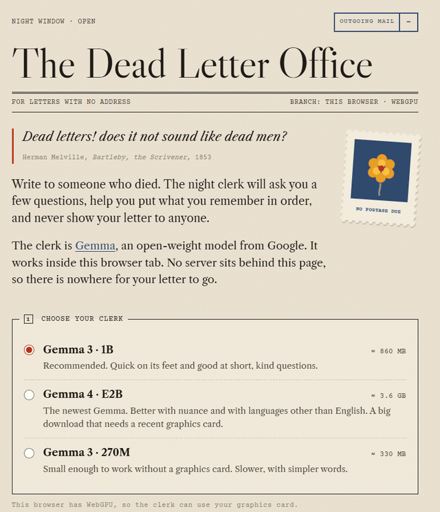

# The Dead Letter Office

> Dead letters! does it not sound like dead men?
> Herman Melville, *Bartleby, the Scrivener* (1853)

**A place to write to someone who died, with a night clerk that lives only in your browser.**

**Try it:** https://nightclerk.github.io/dead-letter-office/ (Chrome or Edge with WebGPU; add `?mock` to walk through without downloading a model, or `?cpu` to force the CPU path)



The Dead Letter Office helps you write a letter to someone you've lost. A small open-weight AI model, Google's [Gemma](https://ai.google.dev/gemma), plays the night clerk: it asks a few questions to help you remember small, concrete things, then puts *your* words in order. When you're done you can keep the letter as a file on your device, or deliver it by fire.

The model runs entirely inside your browser tab with [Transformers.js](https://huggingface.co/docs/transformers.js) and WebGPU. There is no server, no account, no analytics, and no API key. After the model has downloaded once, the office works with the internet switched off.

## Why it has to be open

A letter to your dead mother is about the most private thing you will ever write. It should not pass through a server you don't control, be logged, or be used to train anything. With an open-weight model running locally, it doesn't have to:

- **Nothing leaves the device.** A counter in the corner shows every network request the page makes. Once the clerk is at the desk it should read zero, and every push to this repo is tested for that (see below). The stronger test is yours: switch off your Wi-Fi and keep writing.
- **It costs nothing to run.** No tokens, no subscription, no rate limit.
- **It can't disappear.** The app is static files. The site serves its own copies of Transformers.js, ONNX Runtime and its fonts instead of loading them from a CDN. As long as the open weights exist somewhere, the clerk can be called.

## The clerks

| Model | Download | Runs on |
|---|---|---|
| Gemma 3 · 1B (recommended) | ≈ 760 MB (16-bit GPUs) / 860 MB | WebGPU |
| Gemma 4 · E2B | ≈ 3.1 GB / 3.6 GB | WebGPU, recent GPU |
| Gemma 3 · 270M | ≈ 280 MB / 330 MB | WebGPU or CPU (WASM) |

All are the `onnx-community` ONNX conversions on Hugging Face with 4-bit weights. The app checks whether your graphics card supports 16-bit shader math (`shader-f16`) and picks `q4f16` or `q4` to match. (The first test on a real laptop failed exactly there, so now it asks first.)

## How it works

- `js/ghost-worker.js` loads Gemma in a Web Worker (the file is still called `ghost-worker.js`) with Transformers.js (`pipeline('text-generation', …, { device: 'webgpu', dtype })`) and streams tokens back to the page.
- `js/app.js` runs the ritual: who the letter is for, then up to three questions built from what you've shared.
- **The clerk never writes a word of your letter.** In testing, Gemma 3 1B asked to write a whole letter gave a grandfather a favourite song nobody had mentioned. A tool like this must not put words in a dead person's mouth, so the model only asks the questions, and the letter is made from your answers, word for word. For English, "he" and "his" become "you" and "your" with plain grammar rules (no model). You can edit everything, and ask the clerk for one more question.
- The question prompt shows the model two example questions about other people. A 1B model follows a worked example far better than a list of rules; without them it often answered with a statement instead of a question.
- `js/netwatch.js` wraps `fetch`, `XMLHttpRequest`, `sendBeacon`, `WebSocket` and `EventSource`, and watches the Performance API for any other resource load. The worker reports its own requests too.
- `sw.js` keeps the app's own files on the device so it opens offline; Transformers.js keeps the model in the browser's Cache Storage. Every font is loaded before the clerk arrives, so a Hebrew letter doesn't trigger a font request mid-letter.
- Burning is a CSS mask moving up an airmail sheet with a canvas of embers and ash. Afterwards the text is cleared from the page and from memory, and a postmark is stamped.
- Type: Libre Caslon (display and text), Courier Prime for the clerk, Frank Ruhl Libre for Hebrew. All fonts are self-hosted, so no font service sees your visit.

## GitHub Actions: the clerk must not phone home

`.github/workflows/ship.yml` runs on every push:

1. **Static check** (`scripts/privacy-check.mjs`): our own code may not reference any outside server, only plain links a person can click.
2. **Runtime check** (`tests/smoke.mjs`): a headless Chromium walks through two letters in test mode (`?mock`, canned replies, no model), one in English and one in Hebrew, using every button: skip, ready early, one more question, go back and edit, deliver by fire, return to sender. It records every request. The build fails if a single request happens after the clerk arrives, if the page loads anything that isn't its own file, if the office doesn't open with the network switched off, or if any screen scrolls sideways on a 360px phone.
3. Only then is the site published to GitHub Pages.

`.github/workflows/model-watch.yml` checks once a week that every Gemma model the app offers can still be downloaded, and opens an issue if one has gone missing. An open model is only useful while it can still be downloaded.

## Run it yourself

It's static files. Copy the libraries in once, serve the folder with anything, and open it in Chrome or Edge. Add `?mock` to try the flow without downloading a model.

```bash
npm ci --ignore-scripts
npm run vendor   # copies Transformers.js + ONNX Runtime into vendor/
npx serve .
npm test         # privacy check + end-to-end test
```

## Made with

The Dead Letter Office was built by an AI coding agent (Claude, by Anthropic) working on behalf of the repository owner, for the DEV Hacktoberfest Open-Source AI Challenge, Week 4: *Ghost in the Machine*.

## If you're grieving

This is a small tool, not a substitute for people. If grief is heavy, please reach out to someone you trust or a local support line.

## License

MIT. Vendored libraries keep their own licenses (see `vendor/README.md`); fonts are under the SIL Open Font License (see `fonts/`). Gemma models are subject to the [Gemma Terms of Use](https://ai.google.dev/gemma/terms).
